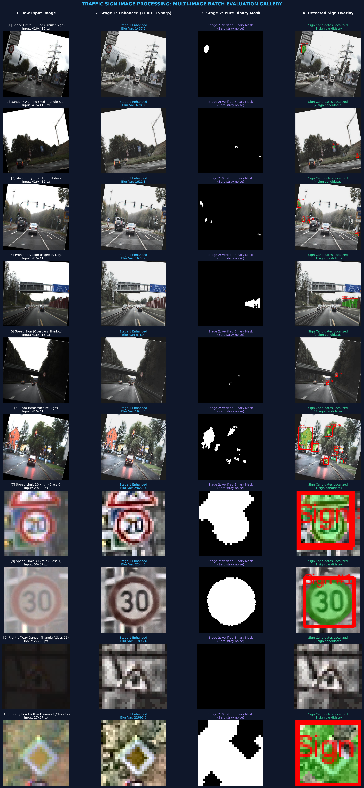
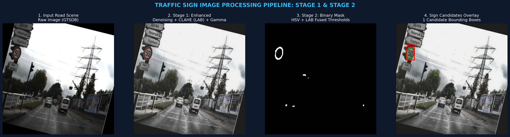
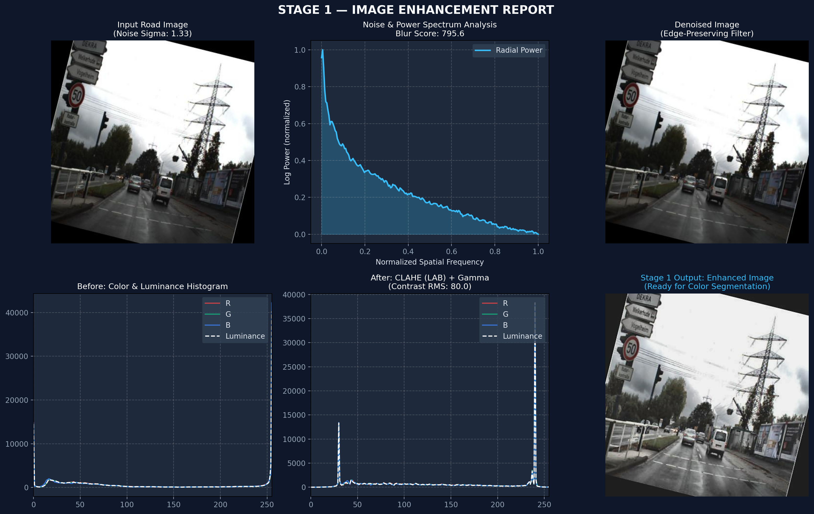
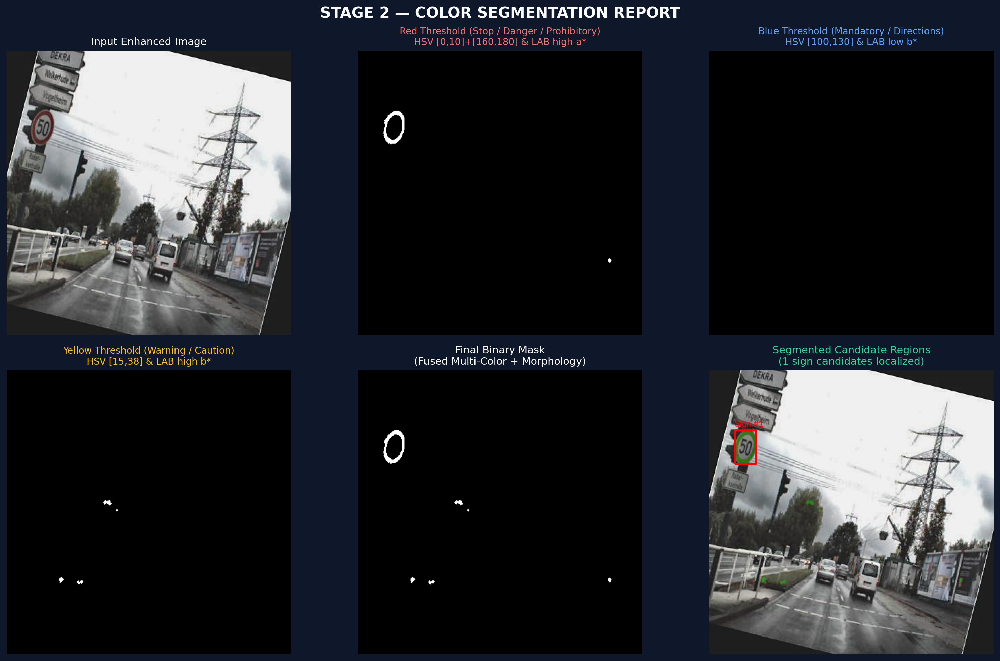

# 🚦 Traffic Sign Image Processing Pipeline (Stage 1 & Stage 2)

[](https://www.python.org/)
[](https://opencv.org/)
[](https://streamlit.io/)
[](https://opensource.org/licenses/MIT)

An end-to-end computer vision pipeline implementing **Stage 1 (Image Enhancement)** and **Stage 2 (Color Segmentation)** for traffic sign detection and recognition using the **GTSDB** (German Traffic Sign Detection Benchmark) and **GTSRB** (German Traffic Sign Recognition Benchmark) datasets.

> [!IMPORTANT]
> **100% Classical Digital Image Processing (DIP)**: This project relies **strictly** on classical image processing and mathematical transforms (Fast Fourier Transform, Immerkaer Laplacian convolution, Bilateral filtering, CIELAB CLAHE, Unsharp Masking, Multi-channel color slicing in HSV & CIELAB, Mathematical Morphology, and Contour Geometry). **No CNNs, Deep Learning architectures, pre-trained weights, or neural networks are used.**

---

## 🖼️ Multi-Image Batch Evaluation Gallery (10 Test Cases)

Evaluated across diverse road scenes (overcast, shadow, highway, urban) and cropped sign classes (Speed Limit 20, 30, 50, Danger Triangles, Mandatory Blue, Priority Diamonds):



---

## 📌 Pipeline Overview



The system transforms raw, noisy, or underexposed road scene images into clean candidate traffic sign segmentations through two dedicated stages:

```
[Raw Road Scene]
       │
       ▼
┌─────────────────────────────────────────────────────────────┐
│ STAGE 1: IMAGE ENHANCEMENT                                  │
│  1. Immerkaer Noise Variance Estimation & 2D FFT Spectrum   │
│  2. Adaptive Edge-Preserving Denoising                      │
│  3. CLAHE (CIELAB L* Channel) & Dynamic Range Normalization │
│  4. Unsharp Masking (High-Frequency Detail Sharpening)      │
└─────────────────────────────────────────────────────────────┘
       │
       ▼
┌─────────────────────────────────────────────────────────────┐
│ STAGE 2: COLOR SEGMENTATION                                 │
│  1. Color Transformations (RGB ➔ HSV and CIELAB)            │
│  2. Dual-Space Saturated Thresholding (Red, Blue, Yellow)   │
│  3. Morphological Closing (Bridge Rings) & Opening (Clean)  │
│  4. Structural Sign Verification & Vehicle Rejection Filter │
└─────────────────────────────────────────────────────────────┘
       │
       ▼
[Binary Mask & Localized Traffic Sign Candidates]
```

---

## ⚡ Stage 1 — Image Enhancement

The goal of Stage 1 is to elevate image quality, remove sensor noise without blurring text or boundaries, and expand the dynamic range of shadowed or overcast road scenes.



### Key Methodologies:
1. **Noise Variance Estimation (Immerkaer's Method)**:
   Measures additive noise standard deviation ($\sigma$) without ground-truth clean images using a Laplacian convolution mask $N$:
   $$\sigma = \sqrt{\frac{\pi}{2}} \cdot \frac{1}{6(W-2)(H-2)} \sum |I * N|, \quad N = \begin{bmatrix} 1 & -2 & 1 \\ -2 & 4 & -2 \\ 1 & -2 & 1 \end{bmatrix}$$
2. **Frequency Domain Power Spectrum**:
   Computes the 2D Fast Fourier Transform (FFT) and azimuthally averaged radial power spectrum to evaluate spatial frequency distribution and blur.
3. **Adaptive Edge-Preserving Denoising**:
   Dynamically scales spatial parameters based on $\sigma$ to ensure small signs and sharp edges are never blurred.
4. **CLAHE in CIELAB Color Space**:
   Applies Contrast Limited Adaptive Histogram Equalization solely to the Luminance ($L^*$) channel, preventing color shifts while stretching dynamic range to $[15, 240]$.
5. **Detail Sharpening (Unsharp Masking)**:
   $$\text{Enhanced} = (1 + \alpha) \cdot I - \alpha \cdot \text{Gaussian}(I, \sigma=1.2)$$
   Restores crisp borders and numbers on signs.

---

## 🎨 Stage 2 — Color Segmentation & Candidate Verification

Stage 2 isolates traffic sign pixels from complex driving scenes, actively rejecting vehicles, brake lights, and road markings.



### Key Methodologies:
1. **Dual-Space Chromatic Thresholding**:
   - **Red Signs** (Stop signs, prohibitory borders, danger triangles):
     - HSV: Hue $[0, 12] \cup [155, 180]$, Saturation $S \ge 65$, Value $V \ge 40$.
     - CIELAB: High positive chrominance $a^* \ge 138$.
     - Intersection (`HSV AND LAB`) ensures rejection of brown asphalt and car paint.
   - **Blue Signs** (Mandatory, directions):
     - HSV Hue $[95, 135]$, $S \ge 65$ and CIELAB $b^* \le 120$.
   - **Yellow Signs** (Warning, caution):
     - HSV Hue $[14, 38]$, $S \ge 70$ and CIELAB $b^* \ge 138$.
2. **Morphological Operations**:
   - Elliptical closing bridges thin circular border rings into solid candidates.
   - Elliptical opening eliminates sub-pixel noise.
3. **Vehicle Rejection & Structural Sign Verification**:
   - **Aspect Ratio Filter**: Traffic signs maintain regular geometric ratios ($0.52 \le w/h \le 1.65$).
   - **Interior Co-Occurrence**: Genuine traffic signs possess interior white/yellow symbols (numbers or pictograms) inside the border. Solid glowing vehicle brake lights are cleanly discarded.
   - **Road Horizon Filter**: Eliminates asphalt lane reflections near the vehicle bumper.

---

## 📂 Project Structure

```text
Image_processing_project/
├── assets/                       # Visual report artifacts for documentation
│   ├── pipeline_summary.png
│   ├── stage1_enhancement_report.png
│   └── stage2_color_segmentation_report.png
├── outputs/                      # Saved run outputs and masks
├── src/                          # Modular Python source package
│   ├── __init__.py
│   ├── config.py                 # Dataclass configurations & calibrated thresholds
│   ├── pipeline.py               # Unified coordinator for Stage 1 + Stage 2
│   ├── visualizer.py             # Diagnostic reports generator
│   ├── stage1_enhancement/
│   │   ├── __init__.py
│   │   ├── noise_analysis.py     # Immerkaer variance & 2D FFT spectrum
│   │   ├── denoising.py          # Adaptive bilateral & NLM filtering
│   │   └── contrast.py           # CLAHE in LAB, gamma & unsharp masking
│   └── stage2_segmentation/
│       ├── __init__.py
│       ├── color_spaces.py       # RGB to HSV & CIELAB channel breakdown
│       ├── thresholding.py       # Dual-space chromatic threshold rules
│       └── morphology.py         # Morphological closing/opening & sign verification
├── app.py                        # Interactive Streamlit Web Dashboard
├── run_pipeline.py               # Command-line runner for batch / single image testing
├── requirements.txt              # Project dependencies
├── .gitignore                    # Excludes dataset weights and zip archives
└── README.md                     # Documentation
```

---

## 🚀 Getting Started

### 1. Prerequisites & Installation

Clone the repository and install required packages:

```bash
git clone https://github.com/<your-username>/Image_processing_project.git
cd Image_processing_project
pip install -r requirements.txt
```

### 2. Running via Command Line (CLI)

Run the full pipeline on a GTSDB road scene or GTSRB cropped sign:

```bash
# Run on default GTSDB road scene sample
python run_pipeline.py --dataset gtsdb

# Run on a GTSRB sign crop sample
python run_pipeline.py --dataset gtsrb --output_dir outputs/gtsrb_run

# Run on any custom image path
python run_pipeline.py --image path/to/your/image.jpg

# Run batch evaluation across 10 diverse test images (creates master_gallery.png)
python run_batch_gallery.py
```

### 3. Running Controlled Detection Experiments

To evaluate the pipeline against ground-truth annotations with strict one-to-one IoU matching at 0.5:

```bash
# Run Phase B & C controlled comparison (Baseline vs Previous Best vs Proposed Independent Morphology)
python run_phase_bc_experiments.py
```

Outputs, per-image CSV metrics, and annotated overlay images (`TP` in green, `FP` in red, `FN` in cyan) are automatically saved to `experiments_phase_bc/`.

### 4. Launching the Interactive Web UI (Streamlit)

Launch the interactive GUI to adjust CLAHE, noise filters, and HSV/LAB threshold sliders in real time:

```bash
streamlit run app.py
```


---

## 📊 Datasets

1. **GTSDB (German Traffic Sign Detection Benchmark)**: Full road scenes (1360×800 or 416×416) containing small signs under varying lighting, shadows, and weather. Used for full detection and background suppression.
2. **GTSRB (German Traffic Sign Recognition Benchmark)**: 50,000+ cropped sign patches across 43 classes used for chromatic profiling and threshold calibration.

---

## 📜 License

This project is licensed under the MIT License - see the LICENSE file for details.
